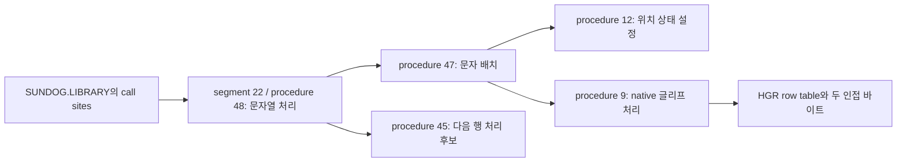

# SunDog game-code reconstruction — 2026-10-23 restart

현재 작업은 원본 코드의 기능을 파악하고 그 의미를 네이티브 게임 코드로 옮기기 위한
역분석이다. 에뮬레이터를 앱에 넣는 작업은 중단하고 관련 미커밋 코드·빌드를
`analysis/local/abandoned-emulator-app/`에 격리했다. 이 문서의 성과는 게임 코드
분석이며, 플레이 가능한 포팅의 완성률로 환산하지 않는다.

## 게임 본체 위치

`SYSTEM.STARTUP`의 block 140 dictionary는 Utility와 Play에서 동일하다. 이
표의 13개 descriptor를 **Play Side**의 해당 block에서 읽으면 모든 payload의
세그먼트 번호, 프로시저 ordinal, self-relative entry가 일치한다. 총 327개
프로시저다. Utility 파일 범위 밖이라고 보류했던 segment 18–21도 포함한다.

| 구분 | 확인한 내용 | 남은 불확실성 |
|---|---|---|
| dictionary | block 140, 양면 SHA-256 일치 | 실제 loader의 disk 선택 조건 |
| payload | segment 1, 7, 8, 12–21의 구조 전부 유효 | 각 segment의 게임 내 역할과 호출 계약 |
| 저장 범위 | 마지막 payload 끝은 block 272 exclusive | 별도 게임 데이터·저장 영역의 용도 |
| 실패 sector | Play T34의 bytes는 읽거나 유효 데이터로 사용하지 않음 | T34의 원래 내용/용도 |

이는 기존 범위 충돌의 **구조적 설명**이다. Play에 유효한 코드가 있다는 사실과
실행 중 올바른 disk를 선택한다는 사실은 구분한다. 이전 앱 실험의 T34 head-read
관찰로 게임 코드가 누락됐다고 단정할 수 없다. 확인한 코드 payload는 모두
독립적으로 검증된 T0–33 안에 있다.

재현: `python3 tools/play_startup_evidence.py`.
근거: `analysis/play-startup-inventory.json`. 원본 코드 추출물은 무시되는
`analysis/regions/play-startup/`에만 보관한다.

## Pascal 코드와 호출 관계

Apple II native handler에서 검증한 operand 길이와 분기 규칙으로 정적 분석기를
구현했다. ST opcode 표를 적용하지 않았다. 분기의 high-bit 형식은 signed PC
변위가 아니라 **프로시저 trailer를 기준으로 고른 self-relative word cell**이다.
`$E239..E244`의 `$54/$55` 설정을 실제 REA/Ghidra에서 다시 확인했다.

- 현재 590개 프로시저 목록, 43,471개 도달 가능한 p-code 명령, 3,310개 정적 call site.
- 이 목록에는 별도 6502 분석 대상으로 구분한 native 프로시저 31개도 포함한다.
- 미확인 `$9E` 서비스에서는 해당 경로를 중단한다. 추측한 길이로 다음 명령을 읽지 않는다.
- call 뒤의 경로는 정상 복귀를 조건으로 한다. 실행된 call trace라고 주장하지 않는다.
- inline 문자열·word·case table을 instruction으로 순차 해석하지 않는다.
- relative archive의 alignment 분석은 even load base를 조건으로 기록한다.

`machine_type=7`인 segment 전체가 6502인 것은 아니었다. 예를 들어 SYSTEM.LIBRARY
segment 22의 63개 프로시저 중 18개는 native이고 45개는 p-code다. Native resolver
`$E14F..E17B`의 zero tag 분기와 각 directory entry로 구분한다.

재현: `python3 tools/pcode_analysis.py`.
공개 가능한 구조·호출·sector provenance: `analysis/pcode-callgraph.json`.
전체 원본 instruction listing은 `analysis/local/pcode/`에만 둔다.

## 문자열에서 실제 HGR 쓰기까지

SUNDOG.LIBRARY에서 external operand 22/procedure 48로 향하는 정적 call site는
현재 도달 범위에서 68개다. P48은 최대 80자의 local string을 준비하고 길이 byte를
읽어 문자를 순회한다. P47은 P12와 P9를 호출하고 논리 cursor 필드를 6 증가시킨다.
P45는 행 관련 필드를 8 증가시키며 다른 줄/영역 처리로 이어진다. 정확한 문자열
줄바꿈·정렬·clipping 규칙은 후속 분석 대상이다.

| 절차 | segment 내 entry | 원본 Utility 위치 | 확인한 범위 |
|---|---:|---|---|
| P48 | `$08E4` | T13/S7 + `$E4`, image 55268 | 문자열 순회와 P47/P45 호출 |
| P47 | `$08AA` | T13/S7 + `$AA`, image 55210 | 위치 설정, P9 호출, cursor +6 |
| native P9 | `$1376` | T14/S12 + `$76`, image 60534 | font offset, row 합성, +6; mode 2 별도 경로 |

위 sector는 DOS logical 번호다. 해당 SYSTEM.LIBRARY bytes는 양면에서 동일하다.
`analysis/graphics-call-chain.json`이 각 entry와 call의 provenance를 기록한다.

기존 보관 RAM에서는 slot 22의 directory pointer가 `$BDCA → $ADAA`이며 payload
base `$95BE`와 크기로 계산한 directory 주소와 일치한다. Native P9는 `$A934`에
있다. Source와 비교한 22개 operand word의 차이는 segment base `$95BE`, data-29
base `$ADBC`, procedure base `$A934` 세 가지로 설명된다. 원본 전체를 runtime
주소에 그대로 올린다고 가정하지 않았다. 이 주소들은 해당 보관 상태의 값이다.

P9는 font pointer에 `character * 8`을 더하고 8행을 처리한다. 행 주소 low/high
표 `$0DC0/$0E80`의 192개 항목은 모두 HGR page-1 공식과 일치한다. 정상 그리기
경로는 bit shift와 mask를 적용해 두 인접 바이트를 AND/XOR 합성하고 x word를
6 증가시킨다. Font 행은 역순으로 읽으며 목적지 행은 증가한다.

이 **정상 합성 body**를 독립적인 bit 식으로 재구성하고, 선언한 합성 font/RAM/
mask/좌표의 420개 경우에 원본 native 명령의 제한된 분석 결과와 대조했다.
79개 실행 instruction 주소는 REA/Ghidra instruction boundary 안에 있다.
호출 준비·좌표 변환·clipping·mode 2·실제 font asset·물리 모니터 색상까지 검증한
것은 아니다. 이것이 고수준 렌더링 재구성의 첫 검증 단위다.

재현: `python3 tools/glyph_evidence.py`, `python3 tools/graphics_call_evidence.py`.
`sh tools/run_graphics_analysis.sh`는 Ghidra project에 6개 label/comment를 저장하고
readback을 검사한다. REA 원본 Evidence/snapshot과 전체 assembly는 local에 둔다.
Evidence ID는 공개 보고서에 연결돼 있다.

## 실제 게임 로직의 다음 분석 대상

Decoded inline text의 참조 위치와 같은 프로시저의 call·산술·table 접근을 함께
기록한 `analysis/subsystem-candidates.json`을 만들었다. 원문 문자열은 공개
보고서에 복제하지 않았다. 아래는 검토 대상이며 역할을 완전히 증명한 이름이 아니다.

- Segment 20: P24/P27/P30/P31 주변 매매·가격·화물 처리 후보.
- Segment 13: 연료·행성·도시 간 항법/우주선 제어 후보.
- Segment 14: 선내 물품·화물 UI 후보.
- Segments 8/19: 도시·행성 정보 표시 후보.
- Segment 12: 선박/잔해·화물 상호작용 후보.

다음은 시작 segment의 `$9E` 초기화 서비스 경계를 확인해 호출 흐름을 이어가고,
위 후보에서 상태 필드의 소유자, 입력 조건, 계산·갱신 순서와 부작용을 복원하는
작업이다. 문자열 발견만으로 거래 규칙이나 저장 자료구조를 구현하지 않는다.
