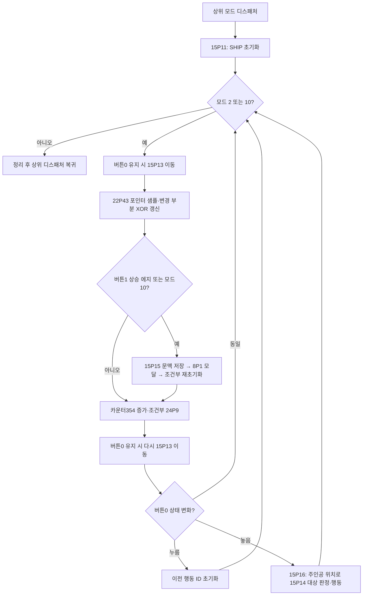

# 게임 메인 루프: SHIP 조이스틱 포인터

이번 분석은 현재 네이티브 앱이 표시하는 최초 SHIP 배경 다음의 원본 동작을 규명한다. 앱 구현은 변경하지 않았다. 주인공 위치와 포인터 위치를 별개 상태로 유지하며, **포인터를 조이스틱으로 지정하고 버튼을 누른 동안 주인공을 이동시킨 뒤, 놓는 순간 주인공 위치에서 행동을 선택**하는 구조다.

## 원본 제어 흐름



모달에서 돌아와도 즉시 루프 조건으로 점프하지 않고 뒤의 주기 처리와 입력 단계를 수행한다. 입력도 반복 중 여러 번 읽으므로 한 프레임의 단일 입력 스냅샷으로 바꾸면 원본과 순서가 달라질 수 있다. 한 반복의 이동 호출 두 번은 포인터 갱신 전후에 배치된다. 상세 주소와 모드 복귀는 [SHIP 루프](ship-main-loop.md)에 기록했다.

## 입력, 이동, 렌더링의 경계

| 상태/동작 | 원본 의미 | 근거 |
|---|---|---|
| 포인터 | paddle 절대 위치를 보정·확대·제한한 좌표 | library22 P5/P42/P61/P62 |
| 주인공 | 포인터와 독립된 좌표, 저장 word40/41에서 복원 | SHIP15 P11/P15 |
| 버튼0 유지 | 목표 anchor `(pointerX−3, pointerY+3)` 쪽으로 축당 최대2 이동 | 15P13 |
| 충돌 | 스프라이트 비트와 화면 비트의 겹침 검사 | native22 P9 mode2 |
| 벽면 이동 | 대각선, 가로, 세로 후보 순으로 시도; 정지 시1픽셀 재시도 | native22 P22 및15P13 |
| 버튼0 놓음 | 포인터가 아닌 주인공 좌표를 시설 격자로 분류 | 15P16→P14 |
| 버튼1 상승 에지 | 문맥 저장 뒤8P1 호출 | 15P1 |
| 포인터 갱신 | 이전 위치 XOR로 지우고 새 위치 XOR로 그림 | 22P41/P43 |

따라서 마우스 클릭 좌표로 시설을 즉시 여는 방식은 원본 행동 계약과 다르다. 또한 조이스틱 기울기를 속도로 해석하는 상대 이동은 현재 확인한 원본 절대 좌표 입력과 다르다. 정확한 계산식·오프셋·범위는 [조이스틱 포인터](joystick-pointer.md), 충돌 후보와 시설 분류는 [행동 판정](ship-actions.md)을 참조한다.

## 현재 저장 파일에서 첫 행동까지

Utility 선택 slot1의 Bowie는 주인공 `(42,103)`을 복원한다. 이는 P14의 column6,row12, action1이다. 포인터가 `(45,100)`이면 목표 anchor가 현재 주인공과 같아 이동량이0이다. 이 조건에서 버튼0 누름→놓음은 새 action1을 선택하고 mode0 및 P4 조종석 계기 그리기로 이어진다. 이는 **실제 저장 데이터와 원본 분기의 조건부 추적**이며 실시간 입력 관측이나 현재 앱의 구현 완료를 뜻하지 않는다.

## 주기 처리와 시간에 관한 한계

15P1은 word354를 증가시키고 word353 이상이면24P9를 호출한다. P11 초기 임계값은15다. 24P9 `$0E06–0E52`를 추가 확인했다. global227을 지역값으로 가져오고 global352를4로 나눈 나머지가0이면22P29를 호출한 뒤 global352를 증가시킨다. 이어24P12/P15, flag40 조건의P13, global227 저장,24P7이 있다. P9 자체에는354 저장이 없다. 간접 호출의 카운터 초기화·각 시스템 효과는 후속 분석 대상이다. **15를 FPS, 밀리초, 게임 내 시간으로 해석하지 않는다.**

24P9 출처는 Utility SYSTEM.LIBRARY slot3(Play와 동일), segment24이며 기계 판독 보고서가 시작 track/sector와 구간 SHA를 포함한다. 정규화 Ghidra 주소는 실제 고정 로드 주소가 아니다.

## 재현과 다음 분석

다음 명령은 원본 식별 검사 후 공개 가능한 메타데이터를 재생성한다. 원본 바이너리와 전체 디스어셈블은 비공개로 유지한다.

```sh
python3 tools/ship_loop_evidence.py
python3 tools/joystick_pointer_evidence.py
python3 tools/ship_action_evidence.py
python3 tools/run_gameplay_analysis.py
python3 tools/game_loop_summary.py
```

REA의 Ghidra12.1.4 provider로 native P5와P22를 재확인하고 비공개 Evidence/snapshot을 보존했다. 기존 Ghidra SunDogNativeComplete 프로젝트에는 정규화 주소 `$4DAA`/`$54FE`의 의미·참조 문서·REA 근거를 저장하고 주석 읽기 및 프로젝트 저장을 검증했다. 공개 메타데이터는 [Ghidra 주석 기록](../analysis/ghidra-gameplay-annotations.json)에 있다.

다음 구현에 필요한 남은 증거는 실제 배경·스프라이트 기반 충돌 재현, 주인공 애니메이션과 마스크, 포인터 glyph, 시설ID별 메뉴 및 효과, 8P1 저장/종료 경로,24P9 하위 시스템과 시간 계측이다. 우선순위는 **포인터·주인공 원본 자원 확보 → 원본 충돌 결과 대조 → 유지 이동/놓음 행동의 네이티브 구현 → action1 조종석 연결**이다. 전체 게임 로직 규명이 끝났다는 결론은 내리지 않는다.
