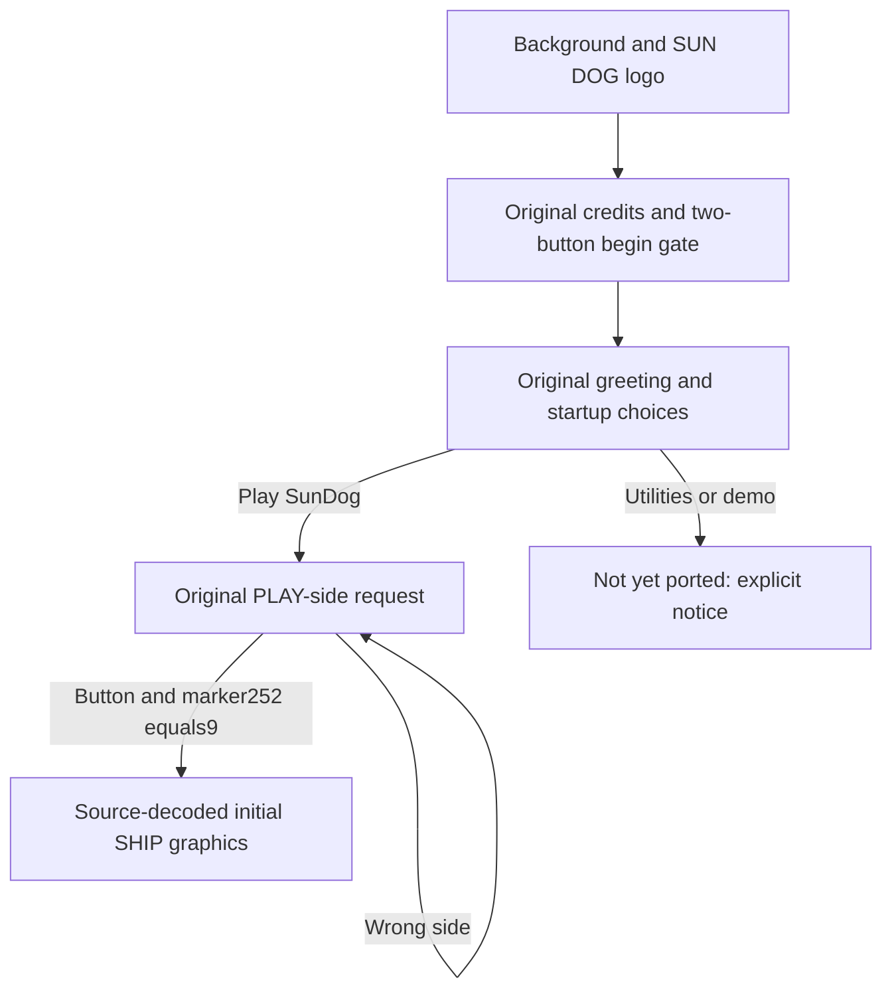

# Native initial-game progress

Version0.6 connects the original title to its first input gate and startup choices.
The supplied media contains the existing playerBowie, with a valid original
checksumA697 and packed stateword32BB. The actual mode is bits8..11 =2; it is not
an invented new-game state or mode3. That mode selects segment15's SHIP path.



The original cross-mode path writes a boot-directory template and reenters the
DiskII ROM. This port represents that decision as an in-memory transition and
never writes either original disk. The next Play gate retains the original
512-byte read/marker252 contract. The bundled source comes from the supplied
Play disk; it is not synthesized from zeroes or from unreadable track34.

Controls in the native window:

- At the begin prompt, click either mouse button or press Space/Return.
- At the menu, click Play SunDog. Return also selects Play; numeric1/2/3 are host
  shortcuts for the original choice IDs (Utilities/Play/Demo).
- At the PLAY-side request, press either button/Space/Return again. The port
  validates its bundled Play-side boot data, then displays the original SHIP image.

The original prompt and menu use the reconstructed P51/P44/P48 window and original
font. Entire prompt and selected reference menu HGR pages match original execution
memory. The menu name in the product comes from the disk save profile; reference
capture names are only comparison fixtures. Mouse hit rectangles come from the
original button geometry, with native macOS coordinates mapped to280x192.

The gate preserves11,400 logical polling iterations and both original button-edge
rules. Sampling at a nominal1,000iterations/second is explicit host policy; it is
not a claim that the original Pascal loop ran for11.4seconds. Background and logo
presentation retain their previously documented timing limits.

The first SHIP image is selected from the saved word82 bit7 and Play resource
blocks29..33. The original native24/P5 strided run-length decoder is rewritten
in Swift. Twenty original-native/Swift cases compare output and consumed source
positions; the selected image digest is
e3f6e1f949b7600953fbacd152c05d8da531a0fd657c9ea19eb7b1fe2c3fdf56.
This is the actual initial graphics resource, not a complete first gameplay frame:
status/cursor overlays, ship controls, movement and subsequent actions remain open.
No fake ship simulation or emulator backend is supplied.

Build from local verified media-derived inputs:

```sh
python3 tools/build_native.py --tests --include-local-assets
open -n Build/SunDog.app
```

The actual executable supports `--diagnose --startup-screen gate`, `choices`,
`play-disk` and `ship`, optionally with `--export-startup PATH.png`. These drive the
same model and button decisions used by the GUI. `tools/verify_startup_app.py`
requires the complete title→begin→choices→Play→SHIP history, checks the source-bound
prompt/image hashes and verifies the disk-derived player/mode. Headless checks
are not described as observed desktop interaction.

Evidence and remaining scope:
[post-title decisions](post-title-flow.md), [rendering](post-title-render.md),
[Play initialization](initial-game-flow.md), [saved profile and SHIP resource](startup-profile.md).

## 2026-10-28 업데이트: SHIP 마우스 조작

앱0.7.0에서 원본 주인공/포인터 글리프를 표시하고, 마우스 이동→포인터,
왼쪽 버튼 유지→충돌을 반영한 보행, 놓음→주인공 위치의 시설 판정을 연결했다.
시설은 선택 안내까지이며 실제 장면/기능·세계 시간·저장은 미구현이다.
상세 조작·원본 근거·호스트 페이싱과 검증은 [ship-mouse-controls.md](ship-mouse-controls.md)를 참조한다.
