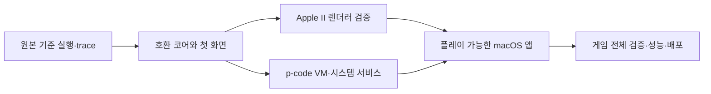

# SunDog Apple II v2.0 → macOS 앱 로드맵

최종 목표는 **원본 Apple II 그래픽과 게임 규칙에 충실한 macOS 앱**이다.
리버스 엔지니어링은 포팅과 검증에 필요한 근거를 만드는 작업으로 배치한다.
단계별 목표와 현재 구현 상태를 함께 기록한다. 전체 게임의 성능·호환성은 아직 검증하지 않았다.

## 현재 위치

- primary opcode 256개 값의 식별 및 선택된 native 경로 검증 완료.
- 실제 REA/Ghidra 증거와 재현 도구 보유.
- HGR page 1의 192개 행 주소 테이블 확인.
- 실제 a2m 부팅→첫 Pascal/BIOS→Ctrl-U→유틸리티 메뉴 관찰.
- Swift HGR decoder의 캡처 24개 픽셀 비교 통과, macOS reference viewer 빌드 완료.
- 독립 실행 코어, 게임 전체 실행, GPU/실제 창 표시 및 저장은 미검증.
- SYSTEM.STARTUP descriptor 4개의 범위 충돌과 Play Track 34 읽기 실패가 남아 있다.

따라서 opcode 목록 완성을 플레이 가능한 포팅의 완성률로 환산하지 않는다.

## 구현 방향

macOS 앱의 창·설정·파일 처리는 SwiftUI/AppKit으로, 화면 표시는 MetalKit으로
구현하는 것을 기본안으로 한다. 게임 화면의 창·글꼴·아이콘·커서는 원본 렌더링
결과를 보존한다. macOS 기본 위젯은 앱 바깥의 설정·미디어 선택 등에 사용한다.
MetalKit의 MTKView는 macOS NSView 기반의 렌더링 표면으로 사용할 수 있다.
[Apple 문서](https://developer.apple.com/documentation/metalkit/mtkview/)

게임 코어는 UI와 분리하고 headless 실행·저장·입력 재생이 가능하게 만든다.
앱과 검증 코어의 기본 구현 언어는 Swift로 두되, 검증용 기존 실행 코어를
도입한다면 정확도와 라이선스를 확인한 뒤 어댑터 뒤에 격리한다.

초기에는 원본 6502 interpreter/native 루틴을 실행하는 호환 경로를 기준으로
사용한다. 이후 검증한 Apple II p-code를 직접 실행하는 엔진으로 교체하고,
native 루틴은 같은 메모리·호출 규약으로 연결한다. 기능별로 원본 경로와 비교한
뒤 교체한다. 처음부터 모든 게임 코드를 Swift로 번역하는 것은 필수 조건이 아니다.

최종 기본 실행 경로는 macOS용 게임 코어다. 6502 경로는 아직 교체하지 않은
원본 native 루틴의 호환 실행과 회귀 검증에 사용한다. 범용 Apple II 에뮬레이터의
모든 주변 장치를 새로 만드는 것은 이 프로젝트의 별도 목표로 삼지 않는다.



## 단계별 산출물과 통과 기준

| 단계 | 구현할 작업 | 산출물 | 통과 기준 |
|---|---|---|---|
| M0 기준 고정 | Apple II 기종·메모리·영상 preset, 게임 버전, 입력 장치와 목표 충실도 정의 | docs/fidelity-spec.md, 기준 장면 목록 | 화면·속도·입력·저장 동작의 비교 방법이 정해짐 |
| M1 원본 기준 실행 | 통제된 실행 환경에서 boot→Pascal→타이틀/첫 UI를 trace; 필요한 9E/BIOS 경로 분석 | 버전 고정 실행 절차, RAM/화면/입력/디스크 trace | 같은 초기 상태와 입력으로 같은 기준 결과 재현 |
| M2 실행·미디어 코어 | 6502/Language Card/메모리, 검증된 디스크 서비스, 가상 시간과 입력 큐 구현 | headless SunDogCore, 미디어 importer, 실행 로그 | 포팅 코어가 기준 타이틀/첫 UI까지 도달하고 메모리·디스크 요청이 대조됨 |
| M3 원본 영상 재현 | 실제 사용 모드, HGR 주소·페이지·글꼴·커서, 색상 생성과 표시 계층 구현 | VideoCore, CPU 기준 decoder, Metal renderer | 기준 시점의 VRAM 일치 및 동일 preset의 결정적 화면 비교 통과 |
| M4 p-code 엔진 | 검증된 명령 decoder/VM, frame·segment·native bridge·9E 서비스 구현 | 실행 가능한 VM, 명령 trace, 서비스 명세 | p-code 경계에서 스택·프레임·메모리 효과·외부 요청·화면이 호환 경로와 일치 |
| M5 플레이 가능한 앱 | 창·입력 focus·마우스/키보드 매핑·음향·일시정지·미디어·저장 UX 연결 | 실행 가능한 .app, 기본 플레이 replay | 부팅→장면 조작→한 게임 활동→저장→재실행·복원 완료 |
| M6 게임 전체 검증 | 거래·화물·우주선·항법·도시/행성·대화·저장 등 시나리오별 복원 | 기능별 replay, 화면 및 상태 기준값 | 각 주요 활동과 장면 전환이 원본과 비교되고 장기 플레이·저장 왕복 통과 |
| M7 성능·동작 조정 | VM·디스크·렌더링 비용 측정, 가상 clock과 입력 sampling 보정 | profiler 결과, 속도 preset, 회귀 결과 | Mac 속도에 따라 게임 규칙·애니메이션·입력 결과가 변하지 않음 |
| M8 배포 | 앱 bundle·설정·미디어 import·버전·오류 보고·서명/공증 검증 | 로컬 release candidate, 사용자 안내 | 개발 도구 없이 대상 Mac에서 설치·실행·플레이·저장 가능 |

M0→M1→M2가 먼저다. M3와 M4는 같은 실행 상태를 기반으로 진행할 수 있다.
M5는 한 활동을 완주하는 첫 제품 단계이고, M6 이후가 게임 전체 포팅 완료 단계다.
배포 공개·push·배포용 신원 사용은 별도의 실제 배포 지시에 따른다.

## Apple II 그래픽 충실도 기준

영상 메모리 해석과 현대 디스플레이 표시를 분리한다.

1. 실제 게임이 사용하는 메모리 페이지·soft switch·모드를 trace로 확정한다.
2. bit 배치, 행 주소, 바이트 경계 및 페이지 전환을 CPU 기준 decoder로 검증한다.
3. 글꼴·텍스트·커서·부분 갱신·XOR/배경 복원을 메모리 쓰기와 함께 분석한다.
4. 색상 preset은 기준 실행 환경과 맞춘다. 아티팩트 색상과 경계 패턴을 테스트한다.
5. Metal 출력은 CPU 기준 decoder와 대조한다. 확대·Retina·전체 화면에서도
   원본 좌표와 입력 좌표의 관계를 보존한다.
6. CRT 필터는 별도 선택 기능이다. scanline 효과만으로 충실도를 판단하지 않는다.

비교는 두 계층으로 한다. 먼저 VRAM bytes와 모드 상태를 비교하고, 이후 같은
영상 preset으로 생성한 프레임을 비교한다. 서로 다른 composite decoder의 RGB가
동일하지 않다는 이유로 게임 로직 오류로 처리하거나, RGB가 비슷하다는 이유로
VRAM 오류를 허용하지 않는다. 렌더러 자체 golden은 선택한 preset 안에서 고정한다.

픽셀 smoothing은 기본적으로 끄고 정수 배율 확대를 제공한다. 화면 비율은 단순히
메모리상의 픽셀 수 비율로 고정하지 않고 기준 디스플레이 preset에서 정의한다.
색상·CRT 외관의 취향과 게임 데이터/화면 갱신의 정확성은 각각 검증한다.

## 코어 교체 시 비교할 상태

- p-code PC, operand stack, local/global frame과 procedure/segment 상태.
- 의미 있는 RAM 변경, native 호출 인자·반환 규약과 뱅크 상태.
- 디스크 요청·저장 결과, 입력 소비 순서와 가상 시간.
- VRAM과 video mode, 음향 이벤트.

아직 초기값이 관찰되지 않은 RAM을 자동으로 0이라고 가정하지 않는다. 비교 대상과
scratch 영역은 근거로 명시하고, 차이를 숨기기 위한 제외 목록을 만들지 않는다.
같은 입력 replay는 초기 snapshot, 가상 clock, 난수/환경 입력, 미디어 hash와 함께
저장한다. 테스트용 snapshot·프레임·게임 데이터는 기존 local-only 정책을 유지한다.

## 실제 플레이 검증 목록

M1에서 원본 수행 방법과 기대 상태를 확인한 뒤 다음 replay를 고정한다.

- 타이틀과 초기 UI, 메뉴 열기/닫기, 커서 이동과 배경 복원.
- 도시 이동, 건물·시설 진입/복귀 및 장면 전환.
- 거래 전후 자금·가격·수량·화물 변화.
- 우주선 조작과 항법, 목적지 이동 및 착륙 후 상태.
- 여러 장소·소지품 상태에서 저장→프로세스 종료→재실행→복원.
- 필요한 디스크 전환, 읽기 실패와 저장 실패 처리.

시나리오가 확인되기 전에는 가상의 경제 규칙이나 입력 장치를 원본 규칙으로
채우지 않는다. 실제 사용하지 않는 기능은 별도 우선순위로 두되, 게임 전체 완료
범위에서 무엇을 제외했는지 명시한다.

## 미디어와 현존 불확실성

첫 배포 모델은 사용자가 가진 원본 미디어를 import하고, 원본 파일에는 쓰지 않는
방식이다. 실행 중 변경은 별도 저장 overlay에 보관한다. 게임 코드·그림을 공개
소스 저장소나 앱 패키지에 포함하지 않는 기존 정책을 유지한다.

Play Track 34는 계속 unknown으로 유지한다. trace에서 필요한 읽기라면 원본 WOZ의
재복구 또는 검증 가능한 미디어 확보가 선행되어야 한다. 실패한 sector를 0으로
대체해 정상 동작으로 간주하지 않는다. SYSTEM.STARTUP descriptor 충돌과 Play Side
선택 조건도 M1/M2에서 해결하거나 실행 범위 제한으로 명시한다.

## 제안하는 추가 구조

```text
macos/                       앱 target·bundle 설정
Sources/SunDogCore/           메모리·VM·서비스·segment·미디어
Sources/AppleIIVideo/         VRAM decoder·색상 preset
Sources/SunDogMac/            앱·입력·Metal 표면
Tests/CoreTests/              코어와 호출 규약 검증
Tests/VideoTests/             합성 VRAM과 렌더러 검증
tools/replay/                 trace 수집·재생·대조
analysis/local/reference/    원본 기준 snapshot·프레임·trace
```

현재 tools/tests/docs/ghidra는 유지한다. 최종 빌드 구조는 M2의 코어 선택을 반영해
확정한다. REA는 native 서비스·경계·호출 추적에, Ghidra scripts/projects는 근거와
주석의 영속화에 계속 사용한다.

## 다음 실행 묶음

1. M0: fidelity spec과 첫 기준 장면 5개를 정의한다.
2. M1: 로컬 실행 도구·ROM·미디어 상태를 조사하고 재현 가능한 원본 실행을 만든다.
3. boot→첫 입력까지 실제로 호출되는 9E/BIOS 경로부터 REA/Ghidra로 추적한다.
4. VRAM·모드·입력·디스크 접근을 포함하는 첫 replay를 확보한다.
5. 그 replay를 통과하는 M2 headless core와 M3 첫 화면 viewer를 만든다.

달력 일정은 M1의 실제 실행과 미디어 의존성이 확인된 뒤 산정한다. 그 전의
완료일 추정은 신뢰하기 어렵다. 진척은 문서량이나 opcode 개수 대신 위 통과 기준과
플레이 가능한 산출물로 보고한다.

## 2026-10-23 구현 상태

M0는 [잠정 충실도 규격](fidelity-spec.md)으로 고정했다. M1의 boot와 첫 입력·메뉴는
[실제 실행 증거](reference-execution.md)를 확보했지만 WOZ/논리 이미지의 이후 경로
차이와 재현 가능한 game-time trace가 남았다. M3는 같은 디지털 preset의 CPU 영상
비교를 통과했고 GPU/다른 모드는 남았다. `Build/SunDog.app`은 reference viewer이며
M2 실행 코어와 M5 플레이 가능한 앱의 통과 조건을 충족한 상태가 아니다.
